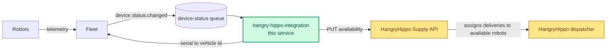

# hangry-hippo-integration

Keeps HangryHippo's view of our robots' availability in sync with Fleet.

HangryHippo is a marketplace for delivering watermelons to hippos at zoos and
wildlife parks. Its dispatcher assigns a delivery to one of our robots only if
we have marked that robot available. This service consumes the status changes
Fleet publishes, decides whether each robot is available, and writes that to
HangryHippo's Supply API.

**Status:** scaffolding only. Each language skeleton connects, consumes, parses
and acks, and does nothing else yet.



Green is this service, the only box you change. Amber is HangryHippo's.

## Getting started

```
make up           # broker, the Fleet emulator and the HangryHippo sandbox
make run go       # or typescript, python, csharp, java
```

We have not settled on a language for this service, so there is a skeleton for
each one we run elsewhere. They are equivalent; use the one you are most
productive in.

## The device-status queue

RabbitMQ on `localhost:5672`, management UI on
[localhost:15672](http://localhost:15672) with `guest` / `guest`. The
`device-status` queue already exists, so you only have to consume.

A message:

```
message_id:   chg_4f1a9c02be71
content_type: application/json

{
  "serial": "C10393",
  "status": "ONLINE",
  "limitingFactors": ["LOW_BATTERY"],
  "observedAt": "2026-09-24T17:02:11.482Z"
}
```

`status` is `ONLINE` or `OFFLINE`. `limitingFactors` is a possibly empty list of
reasons the robot may be unavailable. `message_id` identifies the status change;
`observedAt` is when Fleet saw it, as an RFC 3339 timestamp in UTC with
millisecond precision. A message rejected without requeue goes to
`device-status.dlq`.

## Fleet, `localhost:4001`

Owns the state of every robot.

| Endpoint | Returns |
|---|---|
| `GET /v1/devices/{serial}` | Fleet's current record for a robot: `serial`, `status`, `limitingFactors`, `observedAt`, `hub`. 404 if unknown. |
| `GET /v1/devices/{serial}/partner-accounts/hangry-hippo` | The robot's HangryHippo account: `serial`, `partner`, `vehicleId`. 404 if the serial is unknown or the robot is not registered with HangryHippo. |
| `GET /v1/devices` | Every seeded robot. Useful for finding serials to test with. |
| `GET /v1/health` | |

## HangryHippo Supply API, `localhost:4002`

HangryHippo's platform. We do not own it and we cannot change it. It calls our
robots vehicles, identified by its own vehicle ids; Fleet maps a serial to one.

**`PUT /v1/vehicles/{vehicleId}/availability`** sets whether HangryHippo may
assign deliveries to that vehicle. Typically takes 600 to 800ms. 404 if the
vehicle id is unknown, 503 when HangryHippo is shedding load.

```
PUT /v1/vehicles/veh_8f21c4/availability
{ "available": true }

204 No Content
```

**`GET /v1/vehicles/{vehicleId}/availability`** is what HangryHippo currently
believes. 404 before anything has been written.

## Commands

```
make run go              # start the consumer. also typescript, python, csharp, java
make test go             # unit tests
make test go e2e         # end to end tests, against the whole stack
make state               # queue depth, what Fleet published, what HangryHippo received
make reset               # clear HangryHippo's state and purge the queues
make traffic-off         # stop Fleet publishing, for a quiet read. traffic-on resumes
make logs                # logs from the Fleet emulator and the HangryHippo sandbox
make shell               # a terminal in the container, for a package install
```

`make` runs everything in a container on the stack's network, so the `localhost`
addresses above work as written; edit on the host as normal. The Fleet emulator
and the HangryHippo sandbox come from a prebuilt image, and this README is their
contract.

## Testing

Each skeleton comes with one starter test per level. They show where tests live
and how to reach the stack from them. What you test, and at which level, is up
to you.

| Level | Exercises | Needs |
|---|---|---|
| unit | the code on its own, with anything external faked | the dev container only |
| e2e | the whole path: a status change published to the `fleet` exchange, through the consumer, to what HangryHippo ends up believing | `make up`, and `make run` stopped |

### How an e2e run works

`make test <lang> e2e` does the following:

1. Checks nothing else is consuming `device-status`. A consumer left running by
   `make run` would take some of the test's messages, so the run stops if it
   finds one.
2. Starts your consumer in the background, exactly as `make run` would, and
   waits for it to attach to the queue.
3. Runs the e2e tests against it.
4. Stops the consumer. If a test failed, it prints the last 40 lines of the
   consumer's output after the results; the full log is in
   `/tmp/e2e-consumer.log` inside the container.

Each e2e test then follows the same shape:

1. **Isolate the test.** Stop Fleet's background traffic, purge `device-status`,
   wait two seconds for anything your consumer already had in flight, then
   clear HangryHippo's state. From here on, every message on the queue and every
   write HangryHippo records comes from the test.
2. **Publish a status change** to the `fleet` exchange with routing key
   `device.status.changed`, the same way Fleet does. It reaches your consumer
   through the `device-status` queue like any other change.
3. **Poll HangryHippo** with `GET /v1/vehicles/{vehicleId}/availability` until
   something has been written for the vehicle, or give up after 20 seconds.
4. **Assert** on what HangryHippo ends up believing.
5. Turn Fleet's traffic back on.

The test files hold only the tests. The steps above are helpers in a file next
to them, so a new test is a publish, a wait and an assertion:

| Language | Tests | Helpers |
|---|---|---|
| go | `e2e_test.go` (names start `TestE2E`) | `e2e_stack_test.go` |
| typescript | `test/e2e/*.test.ts` | `test/e2e/stack.ts` |
| python | `tests/e2e/test_*.py` | `tests/e2e/stack.py`, with the fixture in `tests/e2e/conftest.py` |
| java | `AvailabilityE2ETest.java` (tagged `e2e`) | `E2EStack.java` |
| csharp | `tests/AvailabilityE2ETests.cs` (trait `Category=e2e`) | `tests/E2EStack.cs` |

The e2e tests share one stack, so they run one at a time. Each isolates itself
before it starts, so their order does not matter. Isolation covers the queue and
HangryHippo only: your consumer runs for the whole of `make test <lang> e2e`, so
anything it holds in memory carries from one test into the next. Fleet's seed data
maps `C10393` to HangryHippo vehicle `veh_8f21c4`; `GET /v1/devices` on Fleet
lists the other robots you can use.

The starter e2e test fails until the consumer writes availability to
HangryHippo.
