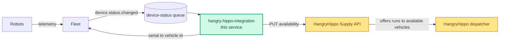

# hangry-hippo-integration

Keeps HangryHippo's view of our robots in sync with the fleet.

HangryHippo is a marketplace for delivering watermelons to hippos at zoos and
wildlife parks. Its dispatcher offers a run to a vehicle only if we have marked
that vehicle available, and it trusts whatever we last told it. This service
consumes the device-status changes our Fleet service publishes, decides whether
each robot can take work, and writes that to HangryHippo's Supply API.

**Status:** scaffolding only. Each language skeleton connects, consumes, parses
and acks, and does nothing else yet.



Green is this service, the only box you change. Amber is HangryHippo's.

## Getting started

```
make up           # broker, the Fleet emulator and the HangryHippo sandbox
make run go       # or typescript, python, csharp, java
```

We have not settled on a language for this service, so there is a skeleton for
each one we run elsewhere. They are equivalent; use the one you are most
productive in.

## The device-status queue

RabbitMQ on `localhost:5672`, management UI on
[localhost:15672](http://localhost:15672) with `guest` / `guest`. The
`device-status` queue already exists, so you only have to consume.

A message:

```
message_id:   chg_4f1a9c02be71
content_type: application/json

{
  "serial": "C10393",
  "status": "ONLINE",
  "limitingFactors": ["LOW_BATTERY"],
  "observedAt": "2026-09-24T17:02:11.482Z"
}
```

`status` is `ONLINE` or `OFFLINE`. `limitingFactors` is a possibly empty list of
reasons the robot cannot take work. `message_id` identifies the state change;
`observedAt` is when the fleet saw it, as an RFC 3339 timestamp in UTC with
millisecond precision.

Delivery semantics, worth reading before you design around them:

- **At least once.** The fleet republishes a change it is not certain landed, so
  the same `message_id` can arrive more than once. A republished message is a new
  delivery: `redelivered` is false on it, exactly as on the first one.
- **No ordering.** Nothing guarantees that two changes for the same robot arrive,
  or are handled, in the order the fleet observed them.
- **Ack or it comes back.** An unacked message is redelivered when the consumer
  disconnects. A `basic.nack` with requeue false sends it to `device-status.dlq`,
  where nothing reads it.
- The fleet publishes continuously while the stack is up, across several robots.

## Fleet, `localhost:4001`

Owns device state for the fleet.

**Availability rule.** A robot is available to take work when its status is
`ONLINE` and none of its limiting factors block it. These block:

| Factor | Meaning |
|---|---|
| `PILOT_REVIEW` | Held for remote pilot review |
| `LOW_BATTERY` | Below the dispatch threshold |
| `HARDWARE_FAULT` | A component reported a critical fault |
| `MAINTENANCE` | Pulled from service by a field operator |
| `OUT_OF_ZONE` | Outside its hub's operating area |

Any other limiting factor is informational and does not block.

| Endpoint | Returns |
|---|---|
| `GET /v1/devices/{serial}` | The fleet's current record for a robot: `serial`, `status`, `limitingFactors`, `observedAt`, `hub`. 404 if unknown. |
| `GET /v1/devices/{serial}/partner-accounts/hangry-hippo` | The robot's HangryHippo account: `serial`, `partner`, `vehicleId`. 404 if the serial is unknown or the robot is not registered with HangryHippo. |
| `GET /v1/devices` | Every seeded robot. Useful for finding serials to test with. |
| `GET /v1/health` | |

## HangryHippo Supply API, `localhost:4002`

HangryHippo's platform. We do not own it and we cannot change it.

- A write typically takes **600 to 800ms**.
- It returns **503** intermittently under load.
- Vehicle ids are HangryHippo's, not our serials. Fleet maps one to the other.

**`PUT /v1/vehicles/{vehicleId}/availability`** sets whether HangryHippo may send
work to that vehicle. 404 if the vehicle id is unknown, 503 when HangryHippo is
shedding load.

```
PUT /v1/vehicles/veh_8f21c4/availability
{ "available": true }

204 No Content
```

**`GET /v1/vehicles/{vehicleId}/availability`** is what HangryHippo currently
believes. 404 before anything has been written.

## Commands

```
make run go              # start the consumer. also typescript, python, csharp, java
make test go             # unit tests
make test go e2e         # end to end tests, against the whole stack
make state               # queue depth, what the fleet published, what HangryHippo received
make reset               # clear HangryHippo's state and purge the queues
make traffic-off         # stop the fleet publishing, for a quiet read. traffic-on resumes
make logs                # logs from the Fleet emulator and the HangryHippo sandbox
make shell               # a terminal in the container, for a package install
```

`make` runs everything in a container on the stack's network, so the `localhost`
addresses above work as written; edit on the host as normal. The Fleet emulator
and the HangryHippo sandbox come from a prebuilt image, and this README is their
contract.

## Testing

Each skeleton comes with one starter test per level. They show where tests live
and how to reach the stack from them. What you test, and at which level, is up
to you.

| Level | Exercises | Needs |
|---|---|---|
| unit | the code on its own, with anything external faked | the dev container only |
| e2e | the whole path: a change published to the fleet exchange, through the consumer, to what HangryHippo ends up believing | `make up`, and `make run` stopped |

`make test <lang> e2e` starts the consumer itself, runs the e2e tests against
it, and stops it afterwards, so stop `make run` first. If a test fails, the tail
of the consumer's output is printed after the results. The starter e2e test
fails until the consumer writes availability to HangryHippo.
